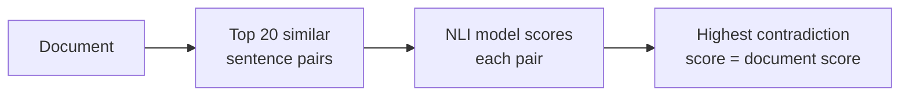
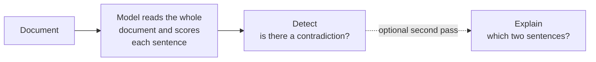
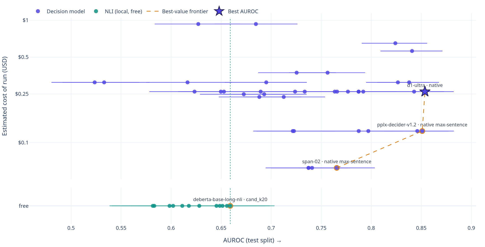
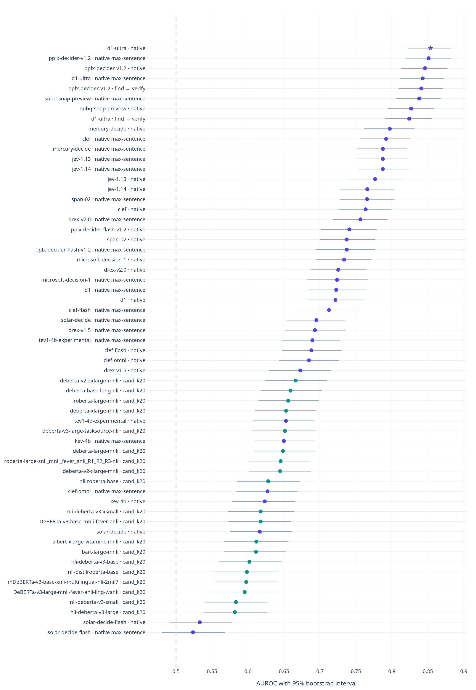
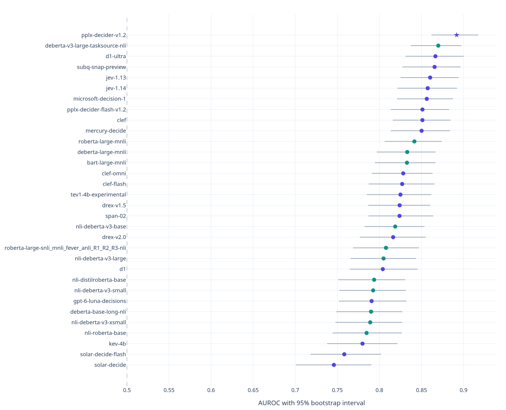
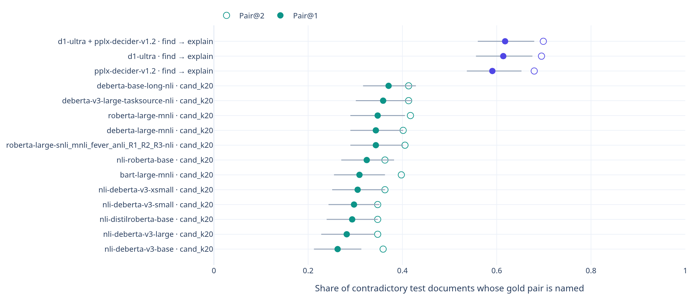

# contradiction-bench

How well do shipped, off-the-shelf models find self-contradictions in real documents?

This benchmark runs 20 hosted decision models (every decision model on OpenRouter, plus SubQ
Snap) and 12 public 3-way NLI models on [ContraDoc](https://github.com/ddhruvkr/CONTRADOC)
(Li et al., NAACL 2024): 891 documents, 449 with a planted contradiction and 442 without. Every
number below is on a held-out test split of 624 documents, with thresholds tuned on a separate
dev split and 95% bootstrap intervals.

## How it works

### NLI models (local, free)



### Decision models (hosted)



Both families are also scored on the same sentence pairs (`pair_test`), which compares the
models apart from how candidate pairs are found.

## Findings

- **Classifying a pair is not the same as finding a contradiction in a document.** Given the gold
  pair, the best NLI model (tasksource DeBERTa-v3-large, AUROC 0.870) is statistically tied
  with the best decision model (Perplexity Decider v1.2, 0.892). Given a whole document, the
  best NLI pipeline reaches only 0.659, while D1 Ultra reading the whole document reaches 0.854.
- **Candidate retrieval is the bottleneck for pairwise methods.** The top 20 TF-IDF sentence
  pairs contain the gold pair in only 59.5% of documents. BM25, dense retrievers and hybrids do
  no better at K=20, because contradicting sentences often aren't similar: 12% of gold pairs
  share no content words.
- **Whole-document judging works best for detection.** The six best document-level systems all
  read the entire document, and none of their gaps to the best is significant. Every pairwise
  system trails them by a significant margin.
- **A second pass helps explanation, not detection.** Shortlisting suspicious sentences and then
  asking "which sentence does this contradict?" doesn't beat native detection (0.841 vs 0.854).
  It does name the exact gold pair in 61.8% of contradictory documents, against 37.1% for the
  best NLI pipeline. See [`results/verify.md`](results/verify.md).
- **Option order matters.** Pair questions are asked twice with the options reversed. For all
  but one model, reversing them moves the answer by 0.01–0.07 on average.

## Results

### Document level: cost vs AUROC



Each point is one system and configuration, with its 95% bootstrap interval. The dashed line
traces the best-value frontier. NLI models run locally and are free; the dotted line marks the
best of them. Costs are estimates: catalogue price × estimated tokens.

<details>
<summary>All document-level systems, ranked</summary>



</details>

### Pair level: gold pairs vs the hardest pair in each clean document



Decision models are purple, NLI models teal.

### Naming the pair



Pair@1 counts documents where the top predicted pair is the gold pair, over the 259
contradictory test documents with a labelled partner sentence.

Full tables, including per-type, per-scope and per-length breakdowns, are in
[`results/report.md`](results/report.md). Raw metrics are in
[`results/metrics.json`](results/metrics.json).

## Method

- **Two tests.**
  - `pair_test`: the 321 gold contradictory pairs against the most similar sentence pair in each
    of the 442 clean documents. Every model sees identical inputs.
  - Document level: all of ContraDoc. Pairwise systems (NLI, and decision models asked about one
    pair) score the top 20 TF-IDF pairs per document and take the max. In native mode a decision
    model reads the whole document and answers one question per sentence plus one for the
    document.
- **Split.** Stratified 30% dev / 70% test (seed 0). Thresholds for F1 are tuned on dev only.
  Always answering "contradiction" is the floor (F1 0.669).
- **Uncertainty.** AUROC is the headline metric, with 95% percentile bootstrap intervals over
  test documents. To compare two systems, use the paired "gap to best" column: it resamples the
  same documents for both systems, so it is much tighter than the per-system intervals.
- **NLI** scores both directions of each pair and takes the max contradiction probability.
- **Decision models** all get the same request body through OpenRouter's decisions API or
  SubQ's direct API. Each model is probed once with the longest input before the full run, so
  an undocumented size cap shows up early.
- **Partial runs are not reported.** A system appears only if it scored every item of an input.

### Coverage and gaps

- ScaleDown Classify-1 is not run, because it can't accept the shared request body. GPT-6 Luna's
  native run is missing one document, which the provider refuses.
- 7 of the 19 NLI models in `cbench.nli` were too slow to finish on CPU: the three MoritzLaurer
  DeBERTa models, VitaminC ALBERT-xlarge, and Microsoft DeBERTa xlarge, v2-xlarge and
  v2-xxlarge.
- Decision models were not run on the top-20 candidate pairs, which would cost about $6 more.

## Reproduce

Requires Python 3.12 and [uv](https://docs.astral.sh/uv/). Torch installs from the CPU index.

```bash
uv sync --all-groups
uv run python -m cbench.fetch            # ContraDoc at a pinned commit, sha256-checked
uv run python -m cbench.candidates --k 20

uv run python -m cbench.nli sweep        # local NLI models, hours on CPU
uv run python -m cbench.sweep catalog    # live OpenRouter decision-model catalogue
uv run python -m cbench.sweep estimate   # token and cost estimate
uv run python -m cbench.sweep probe
uv run python -m cbench.sweep run        # needs OPENROUTER_API_KEY and SUBQ_API_KEY in .env
uv run python -m cbench.verify --verifier perplexity/pplx-decider-v1.2

uv run python -m cbench.evaluate         # writes results/report.md and metrics.json
```

All scores are cached under `results/cache/`, and every scorer resumes where it left off. Each
cached row stores a fingerprint of the exact text scored, so changing sentence splitting
re-scores only the affected items. `--limit N` scores a seeded random sample. The full
decision-model sweep on `pair_test` and native mode costs about $6.

### Explorer

```bash
uv run streamlit run app/streamlit_app.py
uv run python app/export_charts.py       # regenerate the charts in docs/img/
```

The explorer has a cost-vs-AUROC leaderboard and a page for comparing systems.

## Layout

| Module | Purpose |
|---|---|
| `cbench.fetch` | download ContraDoc |
| `cbench.data` | sentence splitting, gold evidence location, dev/test split |
| `cbench.candidates` | `pair_test` and top-K TF-IDF candidate pairs |
| `cbench.nli` | 3-way NLI scoring |
| `cbench.decide` | decision-model client (OpenRouter, Vercel AI Gateway, SubQ) |
| `cbench.sweep` | decision-model catalogue, cost estimate, probe and run |
| `cbench.verify` | find → verify and find → explain over native runs |
| `cbench.evaluate` | report with bootstrap intervals and breakdowns |
| `app/` | Streamlit explorer |

## Data and citation

ContraDoc is © its authors and released under Apache-2.0. It is downloaded at run time and not
redistributed here.

```bibtex
@inproceedings{li-etal-2024-contradoc,
  title     = {{ContraDoc}: Understanding Self-Contradictions in Documents with Large Language Models},
  author    = {Li, Jierui and Raheja, Vipul and Kumar, Dhruv},
  booktitle = {Proceedings of NAACL 2024},
  year      = {2024}
}
```

## License

Apache-2.0, the same as ContraDoc. See [LICENSE](LICENSE).
